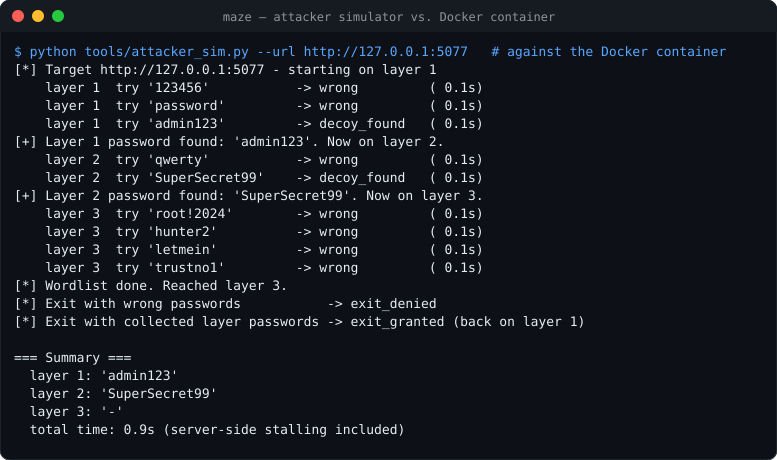
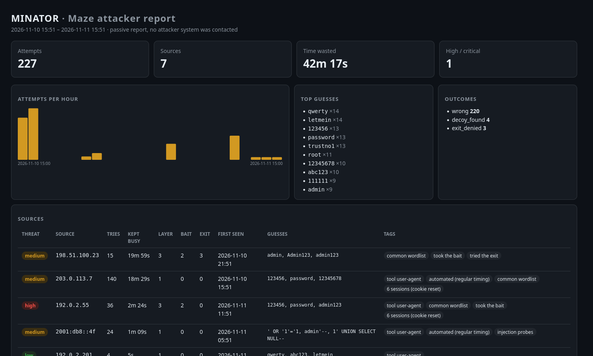
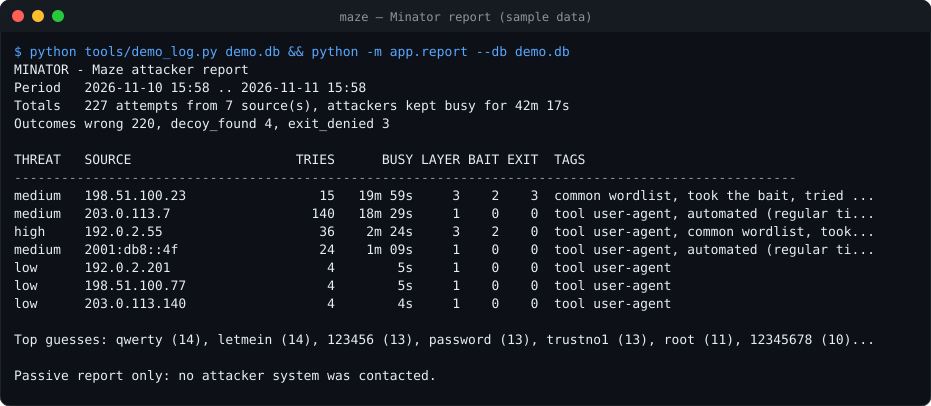
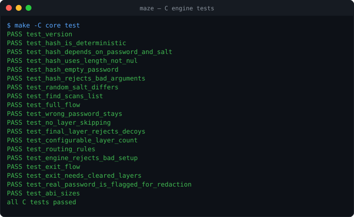
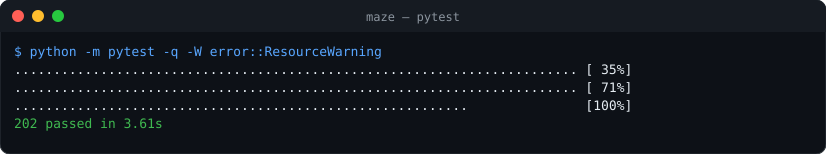
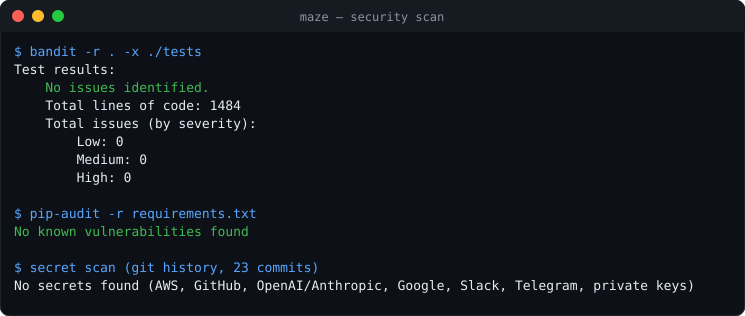

# Maze

[](https://github.com/fas0ftware/maze/actions/workflows/ci.yml)


Maze is a layered honeypot and deception service. It shows a fake web login
page. An attacker who starts guessing passwords is led through a maze of fake
progress: every correct decoy says "First password found" and asks for the
next one, the last layer rejects everything except the real password, and a
fake exit sends them back to the start. Replies get slower, and every move is
logged. The point is to keep the attacker busy, and to buy time to find them.

> **Status:** v0.3. The core engine is written in **C** (`core/`, libsodium
> Argon2id). A small Python/Flask layer serves the web pages, keeps sessions,
> throttles and logs, and calls the engine through `ctypes`. New in v0.3:
> **Minator** (a passive attacker report), a **Docker image**, and a
> **timing test** that proves the final layer has no timing oracle.
>
> **For local testing only.** Do not expose Maze to the internet without isolation.

## Contents

- [Concept](#concept)
- [Quick start](#quick-start)
- [How it works](#how-it-works)
- [Configuration](#configuration)
- [Logging](#logging)
- [Minator: attacker report](#minator-attacker-report)
- [Docker](#docker)
- [Testing](#testing)
- [Project layout](#project-layout)
- [Security notes](#security-notes)
- [Roadmap](#roadmap)

## Concept

```
            decoy 1                decoy 2               real password
 Layer 1 ───────────▶ Layer 2 ───────────▶ Layer 3 ───────────▶ "Access granted"
   ▲  "First password      "Second password     │ decoys / anything else:
   │   found"               found"              │ "Wrong password."
   │                                            │
   └──────── fake exit: repeat decoy 1 + decoy 2 ┘
```

- Layers 1 to N-1 each have a list of **decoy** passwords: plausible passwords
  an attacker will find in wordlists. A decoy moves the session on.
- The **final layer** accepts only the real password. A guess there is compared
  in constant time with the real password **and** every decoy, so the reply
  time does not tell the attacker whether they typed the real password, a
  decoy, or anything else. Decoys get "Wrong password."
- To leave, the attacker must confirm the decoys they used on layers 1 and 2.
  That only sends them back to layer 1: more time spent, more log data.
- No password is stored in plain text. Decoys and the real password are kept
  only as Argon2id hashes.

## Quick start

Requires a C compiler, `make`, libsodium and Python 3.10 or newer.

```bash
git clone https://github.com/fas0ftware/maze.git
cd maze
sudo apt install libsodium-dev pkg-config     # Debian/Ubuntu
make -C core                                  # builds core/build/libmaze.so

python3 -m venv venv
source venv/bin/activate
pip install -r requirements.txt

# Hash the real password (asked twice, never echoed). Use a long random one.
eval "export $(python -m app.hashtool real)"
python -m app            # serves http://127.0.0.1:5000
```

`python -m app.hashtool real` prints one line,
`MAZE_REAL_PASSWORD_HASH='$argon2id$v=19$m=19456,t=2,p=1$…$…'`. You can also put
that line into a `.env` file (git-ignored, see `.env.example`) and load it with
`set -a; source .env; set +a`.

The shipped `config/layers.json` has demo decoys that match
`tools/wordlist.txt`. To use your own, see [Decoys](#decoys).

### Example run

The attacker simulator against the Docker image (`MAZE_DELAY_ENABLED=0`):



`root!2024` and `letmein` are decoys too, but on the final layer they are just
"wrong". With delays on (the default) the same run waits 1, 2, 4, then 8
seconds per failed guess. Part of the log afterwards:

```
layer | outcome      | password
1     | wrong        | 123456
1     | decoy_found  | admin123
2     | decoy_found  | SuperSecret99
3     | wrong        | root!2024
3     | exit_denied  | guess | guess
3     | exit_granted | admin123 | SuperSecret99
```

## How it works

### Architecture

```
 HTTP ─▶ Flask (app/)                         C engine (core/, libmaze.so)
         routes, templates, security headers   layers, routes, Argon2id,
         sessions, per-IP throttle, SQLite log constant-time final layer, exit
                     │      ctypes (app/core.py)       ▲
                     └─────────────────────────────────┘
```

The engine makes every decision. Python never compares passwords.

### Layers

| Layer | What is checked | On match |
|------:|-----------------|----------|
| 1 … N-1 | That layer's decoy hashes | "First/Second/… password found", go to the layer's `on_match` (default: next) |
| N (final) | The real password hash, plus every decoy (constant time) | Real: "Access granted". Decoy or other: "Wrong password." |

- A wrong guess goes to the layer's `on_wrong` target (default: stay).
- A decoy only works on its own layer. The real password works **only** on the
  final layer. A layer cannot be skipped: the current layer is kept on the
  server, never taken from the client, and an out-of-range layer is rejected.
- `layer_count` can be 1 to 16 (default 3), with up to 64 decoys per layer.
- Session state is kept **on the server**, in memory: the current layer and the
  **hashes** of the decoys that cleared each layer. The cookie only holds a
  random session id. A session is created only by a login or exit attempt, and
  expires after `limits.session_ttl_seconds` of inactivity (default 1 hour).

### Constant-time checks

Every login guess and every exit answer, on every layer, costs exactly two
Argon2id hashes: one with the shared decoy salt, one with the real password's
salt. On the final layer the result is compared with the real hash and with
every decoy hash, always scanning the whole list, with no early exit and no
branch on the result (`maze_hash_find`, `sodium_memcmp`). So the reply time is
the same for the real password, a decoy, and a wrong guess.

On top of that, the per-IP delay is applied **before** the guess is evaluated
(see [Delays and rate limits](#delays-and-rate-limits)).

### Fake exit flow (stalling, not security)

`/exit` asks the attacker to "confirm" the password of every layer already
cleared. The answers must be the exact decoys this session used. If they
match, the session goes back to layer 1. If they don't, the exit is denied and
the delay grows.

**This is not a real lock or access control.** It only wastes the attacker's
time and produces more log data. Nothing is protected by it.

### Delays and rate limits

Every login or exit attempt waits before it gets a reply. The wait depends only
on how many times **this IP** failed recently: 1s, 2s, 4s, then 8s (the cap).

- **No timing oracle.** The delay is applied before the password is checked,
  and the check itself takes constant time.
- **Keyed by IP, not by session.** Dropping the cookie does not reset the delay,
  and neither does finding a decoy. The counter resets after
  `reset_after_seconds` (default 900) with no failures, or on the real password.
- **Concurrency caps.** At most 2 requests per IP and 32 in total are processed
  at once (configurable). Extra requests get HTTP 429 at once, before any
  hashing, so sleeping threads and hash work cannot pile up.
- **No machine-readable tells.** Every evaluated attempt returns HTTP 200 and
  the same page. Only the visible message differs.
- **IPv6 is grouped by /64**, and IPv4-mapped IPv6 shares the IPv4 delay. The
  log still stores the exact address.
- **Oversize bodies are ordinary failures.** A body over 16 KB gets the normal
  "Wrong password." page, is delayed, counted and logged (outcome `oversize`).

Worst-case guessing rates on the final layer with the default settings:

| Attacker | Max rate |
|----------|----------|
| One IP | 2 slots / 8 s = **0.25 guesses/s** |
| Many IPs (a botnet) | CPU-bound: each guess costs ~0.1 s of one core, at most 32 at once (global cap), so **~10 guesses/s per core** |

Maze slows attackers down. It does **not** make a weak password strong. Use
60+ bits of entropy for the real password, for example 12+ random characters.

## Configuration

### Environment variables

| Variable | Default | Purpose |
|----------|---------|---------|
| `MAZE_REAL_PASSWORD_HASH` | *(required)* | Argon2id PHC hash of the real password, from `python -m app.hashtool real` |
| `MAZE_LAYERS_PATH` | `./config/layers.json` | Layer config |
| `MAZE_LIB` | `./core/build/libmaze.so` | Path of the C engine |
| `MAZE_HOST` | `127.0.0.1` | Bind address (prints a warning when not loopback) |
| `MAZE_PORT` | `5000` | Port |
| `MAZE_SERVER` | `waitress` | `waitress` (production WSGI server: a fixed thread pool, slow clients cannot tie up threads, at most 500 open connections, no `Server` header) or `dev` (Flask's development server, local debugging only) |
| `MAZE_DB_PATH` | `./maze.db` | SQLite log file |
| `MAZE_DELAY_ENABLED` | from config | `0` turns delays off (demos only) |
| `MAZE_SECRET_KEY` | random per start | Cookie signing key |

The plain-text `MAZE_REAL_PASSWORD` of v0.1 is refused at startup, so it cannot
be left in an environment by mistake.

### `config/layers.json`

| Key | Meaning |
|-----|---------|
| `layer_count` | Number of layers, 1 to 16. The last one is the final layer. Default 3 |
| `decoy_kdf.salt`, `.opslimit`, `.memlimit_kib` | Argon2id salt (base64, 16 bytes) and cost shared by all decoys |
| `layers.<n>.decoys` | Base64 Argon2id hashes of layer *n*'s decoys (1 to 64). Not allowed on the final layer |
| `layers.<n>.on_match` | Layer to go to when a decoy matches. Default *n*+1 |
| `layers.<n>.on_wrong` | Layer to go to on a wrong guess. Default *n* (stay). For example `1` on the final layer restarts the maze |
| `delay.enabled`, `.base_seconds`, `.max_seconds`, `.reset_after_seconds` | Back-off curve |
| `limits.per_ip_concurrency`, `.global_concurrency` | Requests processed at once |
| `limits.max_sessions`, `.session_ttl_seconds` | Session store size and idle timeout |
| `logging.max_password_length`, `.max_user_agent_length`, `.max_rows` | Log truncation and retention |

Every value is validated at startup. A wrong type or an out-of-range value
stops the service with a clear `ConfigError`.

### Decoys

Write the decoys in plain text in a file **outside the repository** (or name it
`config/*.plain.json`, which is git-ignored), then hash it:

```json
{
  "layer_count": 3,
  "layers": {
    "1": {"decoys": ["admin123", "Winter2024!", "letmein", "P@ssw0rd"]},
    "2": {"decoys": ["root!2024", "SuperSecret99"], "on_wrong": 1},
    "3": {"on_wrong": 1}
  },
  "delay": {"enabled": true, "base_seconds": 1, "max_seconds": 8, "reset_after_seconds": 900}
}
```

```bash
python -m app.hashtool decoys my-decoys.plain.json -o config/layers.json
python -m app.hashtool real          # then hash the real password again
```

`hashtool real` reads `config/layers.json` (or `--config`) and refuses a real
password that is also a decoy. Both commands take `--opslimit` and
`--memlimit-kib`. The default cost is t=2, m=19 MiB (the OWASP minimum for
Argon2id): about 0.1 s and 19 MiB per guess on a desktop CPU.

## Logging

Every attempt is written to SQLite. The `attempts` table is created
automatically if it is missing.

| Column | Meaning |
|--------|---------|
| `ts` | Unix timestamp |
| `ip` | Client address (`remote_addr`; `X-Forwarded-For` is ignored) |
| `session_id` | Opaque server-side session id |
| `action` | `login` or `exit` |
| `layer` | Layer the attempt was made on |
| `password` | Attempted password(s); exit answers are joined with ` \| ` |
| `outcome` | `wrong`, `decoy_found`, `real_success`, `exit_denied`, `exit_granted`, `exit_unavailable`, `throttled`, `oversize` |
| `user_agent` | Client User-Agent |
| `seconds_since_prev` | Seconds since the previous attempt from the same IP |

All input is treated as untrusted:

- Every SQL query is parameterized.
- Passwords and User-Agents are truncated and control characters are escaped.
- The real password is **never** logged when it is typed exactly, on any layer
  or as an exit answer: it is replaced by `[REDACTED:REAL_PASSWORD]`. Maze only
  knows the real password's hash, so a near-miss (a trailing space, one wrong
  character, the password inside a longer string) cannot be recognised and is
  logged as typed. **Treat the log as sensitive.**
- Throttled requests are rejected before any hashing, so their guess is not
  stored (`[not stored: throttled]`).
- Request bodies are capped at 16 KB. A larger body counts as a failed attempt.
- Only the newest `logging.max_rows` rows are kept (default 100000).
- A newly created database file gets mode `0600`.

```bash
sqlite3 maze.db "SELECT datetime(ts,'unixepoch'), ip, layer, outcome, password FROM attempts ORDER BY id DESC LIMIT 20"
```

## Minator: attacker report

Minator turns the attempt log into a report: who attacked, for how long they
were kept busy, how deep into the maze they got, and what kind of attacker
they look like. It **only reads** the log (opened read-only); it never contacts,
blocks or probes anyone.

```bash
python -m app.report                              # text report of ./maze.db (or MAZE_DB_PATH)
python -m app.report --format html -o report.html # self-contained HTML (written with mode 0600)
python -m app.report --format json --since 24     # last 24 hours as JSON
python tools/demo_log.py demo.db && python -m app.report --db demo.db   # try it on sample data
```

Per source it reports attempts, **time kept busy** (gaps between attempts,
ignoring pauses longer than 30 minutes), sessions, deepest layer, decoys taken,
exit attempts, guess timing and user agents, and tags such as:

| Tag | Meaning |
|-----|---------|
| `tool user-agent` | Hydra, sqlmap, curl, python-requests, Go-http-client, … |
| `automated (regular timing)` | Gaps between guesses vary by less than 15 % |
| `common wordlist` | Most guesses are in a list of the most common leaked passwords |
| `injection probes` | SQL injection, XSS, Log4Shell, path traversal payloads in the password field |
| `took the bait` / `tried the exit` | Found a decoy / used the fake exit |
| `N sessions (cookie reset)` | Dropped the cookie to try to reset its state |
| `REAL PASSWORD USED` | The real password was entered: threat level **critical** |



<details><summary>Text output</summary>



</details>

The sample log uses only documentation addresses (RFC 5737 / RFC 3849). All
attacker-supplied text is escaped in every format, and the HTML report carries
a `default-src 'none'` Content-Security-Policy, so it can never run script.

## Docker

```bash
docker build -t maze .
# hash the real password on the host (python -m app.hashtool real), then:
docker run --rm -p 127.0.0.1:5000:5000 --read-only --tmpfs /tmp \
  --cap-drop ALL --security-opt no-new-privileges \
  -e MAZE_REAL_PASSWORD_HASH='$argon2id$v=19$...' -v maze-data:/data maze
docker exec <container> python -m app.report --db /data/maze.db
```

The image is built in two stages: the C engine is compiled **and its tests run**
in the build stage; the runtime stage only contains Python, Flask, libsodium and
`libmaze.so`, runs as an unprivileged user (uid 10001), works with a read-only
root filesystem, stores the log in the `/data` volume and has a health check.
CI builds the image and runs the attacker simulator against it.

## Testing

```bash
make -C core test        # C unit tests
make -C core asan        # the same under AddressSanitizer + UBSan
pip install -r requirements-dev.txt
pytest -v                # Python + end-to-end tests (needs core/build/libmaze.so)
```

The C tests cover:

- Argon2id hashing (determinism, salt, embedded NUL bytes, bad arguments) and
  the constant-time hash lookup
- the full layer flow, wrong passwords, layer skipping and forged layer numbers
- decoys rejected on the final layer, 1- and 5-layer mazes, routing rules
- the exit flow, and flags for redacting the real password

The Python tests drive the same engine through HTTP and cover:

- layer transitions, and the real password on and off the final layer
- exit rules
- hardening: equal delay for right and wrong guesses, a per-IP delay that
  survives cookie loss and decoys, the quiet-period reset, and concurrency caps
- config validation: every bad value (including bad hashes, routes and
  `layer_count`) gives a `ConfigError`, never a traceback; a plain-text real
  password is refused
- sessions: lazy creation, expiry, size cap, a GET flood not evicting real
  sessions, consistent state when requests overlap
- log: sanitizing, retention, file mode, connections closed, redaction of the
  real password when typed exactly (on any layer and in exit answers), and the
  documented limit that near-misses are logged as typed
- SQL injection payloads
- oversize bodies, response headers, IPv6 grouping, entry-point errors
  (including a missing `libmaze`)
- an end-to-end run of the attacker simulator against a real HTTP server

- **timing:** the final layer takes the same time for the real password, both
  decoys and wrong guesses (medians of 150 interleaved runs; measured ratio
  1.001, the test fails above 1.5)
- **Minator:** busy-time maths, bot / wordlist / injection detection, the
  critical tag, escaping of hostile input in text and HTML, read-only access,
  private output files, the sample-log tool

The tests use the cheapest Argon2id settings so they run in seconds. CI runs
the C tests with gcc and clang (plus AddressSanitizer/UBSan), the Python tests
on Python 3.10 to 3.13, bandit and pip-audit, and a Docker smoke test.





### Security scan



### Attacker simulator

```bash
python tools/attacker_sim.py                                   # uses tools/wordlist.txt
python tools/attacker_sim.py --url http://127.0.0.1:5000 --wordlist my_list.txt
```

Like a real attacker, it reads only the visible page text. It refuses any target
that is not a loopback address.

## Project layout

```
core/                C engine (libmaze)
  include/maze.h     Public API
  src/hash.c         Argon2id hashing, constant-time lookup (libsodium)
  src/engine.c       Layers, routes, final layer, exit flow
  tests/             C unit tests (no framework)
  Makefile           Hardened build, test and asan targets
app/
  __init__.py        Flask app and routes
  __main__.py        Entry point: python -m app
  core.py            ctypes binding to libmaze, PHC hash strings
  maze.py            Sessions, messages, log redaction on top of the engine
  hashtool.py        python -m app.hashtool: hash decoys and the real password
  report.py          python -m app.report: Minator, the passive attacker report
  throttle.py        Per-IP back-off delay and concurrency caps
  storage.py         SQLite attempt log and input sanitizing
  config.py          Config loading and validation
  templates/         Login and exit pages
config/layers.json   Decoy hashes, routes and tunables (no plain text)
tests/               pytest suite
tools/
  attacker_sim.py    Local attacker simulator
  demo_log.py        Sample attempt log for trying Minator
  wordlist.txt       Demo wordlist
Dockerfile           Two-stage, non-root, read-only-friendly image
```

## Security notes

- **For local testing only. Do not expose Maze to the internet without
  isolation.** If you run it as a real honeypot, use a separate, disposable
  host, VM or container with no access to real systems or credentials, and
  filter its outbound traffic.
- The C engine is built with `-Wall -Wextra -Werror -Wconversion`, stack
  protector, `_FORTIFY_SOURCE=2`, full RELRO and a non-executable stack, and its
  tests run under AddressSanitizer and UBSan. It uses fixed-size buffers, checks
  every length, and wipes password hashes from memory after use.
- Each guess costs about 19 MiB of memory while it is hashed, so the global
  concurrency cap (32) bounds memory use at about 600 MiB. Lower
  `global_concurrency` or `memlimit_kib` on small machines.
- The prototype uses Flask's development server (also inside the container).
  Sessions and throttle state live in memory and are lost on restart.
- Every response carries `X-Content-Type-Options`, `X-Frame-Options`,
  `Referrer-Policy`, `Cache-Control: no-store` and a strict
  `Content-Security-Policy` (no scripts, no framing).
- Treat the log as hostile data: it holds whatever attackers typed.
- Never commit `.env`, `*.db`, `*.plain.json` or real passwords. `.gitignore`
  covers these. (Commits before v0.2 contain the demo decoys in plain text; they
  are public bait words, not secrets.)

## Roadmap

1. **Layer engine in C**: done in v0.2.
2. **Dwell-time measurement**: done in v0.3 (Minator's "kept busy" time).
3. **Minator**: done in v0.3 as a passive report (text, JSON, HTML). Next:
   per-session timelines and scheduled reports.
4. **Timing tests** for the final layer: done in v0.3.
5. **Docker image**: done in v0.3. Next: persistent session and throttle
   state, an SSH-like entrance. (Production WSGI server: done in v0.3.1.)

Maze will not include hack-back or any offensive action against real systems.

## Changelog

- **0.3.1** – Served by waitress instead of Flask's development server. With 300 slow (slowloris-style) clients the development server ran 301 threads, waitress stays at a fixed pool (37 threads with the default limits) and keeps answering normal requests; open connections are capped and idle ones time out after 30 s. `MAZE_SERVER=dev` keeps the old server for local debugging.

- **0.3.0** – Minator passive attacker report (`python -m app.report`: text / JSON / HTML, busy time, bot / wordlist / injection detection, threat levels), sample-log tool, timing test for the final layer, Docker image (two-stage, non-root, read-only) with CI smoke test, bandit + pip-audit in CI; fixed a start-up crash on Python 3.10–3.13 (a dataclass field named `core` shadowed the module in its own annotation; only Python 3.14 tolerated it); the simulator now reads any layer count.
- **0.2.0** – Layer engine rewritten in C with libsodium Argon2id; hashed decoys and real password only.
- **0.1.0** – Python prototype.

## License

[MIT](LICENSE)
